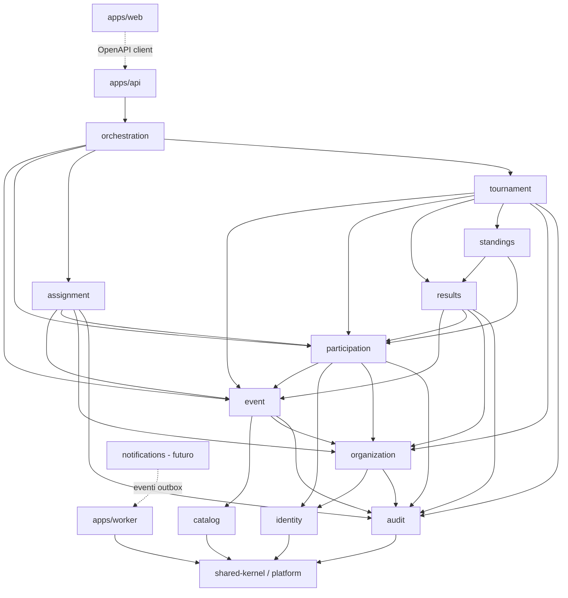

# Module Dependencies

**Fonte normativa:** spec v1.0 §1, §11, §12, §17.2, §19 (AP-01, AP-06), §21.
Status: proposta architetturale. Le scelte strutturali qui descritte devono essere confermate con ADR-001/002/003 (vedi `open-decisions.md`).

## 1. Obiettivi vincolanti

1. Domain layer indipendente da NestJS, Prisma, Clerk, Next.js, HTTP, UI e cloud provider (ARCH-DOM-001).
2. Nessuna scrittura cross-module su tabelle (ARCH-OWN-001).
3. Eventi asincroni solo tramite transactional outbox, committed con la transazione business (OUT-OBX-001/002).
4. Interazioni cross-module solo tramite application service pubblici, query service read-only, eventi, o repository contract approvati (ARCH-OWN-002).
5. **Nessuna dipendenza circolare**, né tra moduli né tra layer.

## 2. Layering interno a ciascun modulo

```
packages/modules/<module>/
  src/domain/          # aggregate, VO, domain service, domain events, porte (interfacce)
  src/application/     # use case/command handler, query service, DTO
  src/contract/        # API pubblica del modulo: interfacce dei service, DTO, ID tipizzati, eventi pubblicati
  src/infrastructure/  # repository Prisma/SQL, adapter (Clerk, RNG...), mapping
  src/index.ts         # esporta SOLO contract/
```

Direzione ammessa (→ = "può importare"):

```
infrastructure → application → domain → shared-kernel
infrastructure → domain
application    → contract ← (altri moduli)
contract       → shared-kernel
```

| Layer | Può importare | Non può importare |
|---|---|---|
| `domain` | `shared-kernel`, librerie pure (nessun I/O) | `application`, `infrastructure`, `contract` di altri moduli, `@nestjs/*`, `@prisma/*`, `@clerk/*`, `next`, SDK cloud, `node:http`, `process.env`, `Date.now()`/`Math.random()` diretti |
| `application` | `domain`, `contract` del proprio modulo, `contract` di moduli **a livello inferiore** (§3), porte `platform` (UnitOfWork, Outbox, Idempotency, Clock) | `infrastructure` di qualunque modulo; `domain` di altri moduli; framework |
| `contract` | `shared-kernel` | tutto il resto |
| `infrastructure` | proprio `domain`/`application`, `@prisma/client`, adapter SDK | `infrastructure`/`domain` di altri moduli; tabelle di altri schemi |

Il wiring NestJS (moduli Nest, controller, guard, DI) vive in `apps/api`, **non** nei package dei moduli **[PROPOSTA ADR-001]**. Così i package di modulo restano framework-agnostic e testabili con test unitari puri.

## 3. Grafo delle dipendenze tra moduli (aciclico, a livelli)

Un modulo a livello *k* può dipendere solo dal `contract` di moduli a livello *< k*. Le dipendenze dello stesso livello sono vietate.

```
L0  shared-kernel            platform (UoW, outbox, idempotency, errors, clock, rng)
L1  identity     catalog     audit
L2  organization                                  (→ identity, audit)
L3  event                                         (→ catalog, organization, audit)
L4  participation                                 (→ event, identity, organization, audit)
L5  assignment                                    (→ event, participation, organization, audit)
L6  results                                       (→ event, participation, organization, audit)
L7  standings                                     (→ results, participation)
L8  tournament                                    (→ event, participation, results, standings, organization, audit)
L9  orchestration                                 (→ event, participation, assignment, tournament; read: tutti)
L10 apps/api (NestJS)        apps/worker (outbox relay)        (→ orchestration + contract di tutti i moduli)
L11 apps/web (Next.js)                            (→ solo client OpenAPI generato)
--  notifications (futuro)                        (→ solo contract degli eventi via outbox; nessuno dipende da lui)
```



### 3.1 Matrice consentito/vietato

Riga = modulo chiamante, colonna = modulo chiamato. `Q` = solo query contract; `S` = service commands; `·` = vietato.

| da \ a | ID | ORG | CAT | EVT | PAR | ASG | RES | STD | TRN | AUD |
|---|---|---|---|---|---|---|---|---|---|---|
| Identity | — | · | · | · | · | · | · | · | · | · |
| Organization | Q | — | · | · | · | · | · | · | · | S |
| Catalog | · | · | — | · | · | · | · | · | · | · |
| Event | · | Q(authz) | Q | — | · | · | · | · | · | S |
| Participation | Q | Q(authz) | · | Q | — | · | · | · | · | S |
| Assignment | · | Q(authz) | · | Q | Q | — | · | · | · | S |
| Results | · | Q(authz) | · | Q | Q | · | — | · | · | S |
| Standings | · | · | · | · | Q | · | Q | — | · | · |
| Tournament | · | Q(authz) | · | Q | Q | · | Q+S | Q+S | — | S |
| Orchestration | · | Q(authz) | · | Q+S | Q+S | Q+S | Q | Q | Q+S | S |
| Audit | · | Q(authz, solo read API) | · | · | · | · | · | · | · | — |

> Audit → Organization è usato solo dalla read API di audit per l'authorization; per mantenere Audit a L1 la verifica del permesso `AUDIT_READ` è eseguita nel controller/use case in `apps/api` prima di chiamare `AuditQueries` **[PROPOSTA]**. Quindi Audit non importa Organization.

### 3.2 Cicli esplicitamente vietati e come sono risolti

| Ciclo potenziale | Perché sarebbe naturale | Risoluzione adottata |
|---|---|---|
| Event ↔ Participation | Event deve contare gli attivi per lo start; Participation deve leggere stato/capacità Event | Participation → Event (Q). Il conteggio per lo start è letto dall'orchestration e passato a `EventService.startTournament(facts)`. |
| Event ↔ Assignment | Start deve lockare gli assignment; Assignment legge pool e stato Event | Assignment → Event (Q). `lockAll` invocato dall'use case `StartTournament`. |
| Event ↔ Tournament | Start inizializza il torneo; completamento dipende dalla progressione; Tournament legge Event | Tournament → Event (Q). `initialize`/`complete` coordinati dall'orchestration. `currentRound` dell'Event è una proiezione non autorevole. |
| Tournament ↔ Results | Results deve sapere i partecipanti del match e se il round è FINALIZED; Tournament deve creare match e verificare readiness | Tournament → Results (Q+S). Results riceve una copia immutabile dei partecipanti in `openMatches`; l'immutabilità post-finalizzazione è data dallo stato `FINAL` impostato da `finalizeAllForRound`. |
| Tournament ↔ Standings | Standings serve al seeding; Standings legge pairing per H2H | Standings → Results (Q) soltanto. Tournament → Standings tramite la porta `SeedingPolicy`. |
| Assignment ↔ Tournament | "Protocol dell'avversario corrente" | Composizione nella read facade di `orchestration`. |
| Organization ↔ qualsiasi | Authorization serve ovunque; Organization potrebbe voler conoscere gli Event | Organization è a L2 e non conosce Event: i permessi sono astratti (`EVENT_MANAGE` su `organizationId`). |

Qualsiasi nuova freccia che risalga i livelli richiede un ADR.

## 4. Transazioni cross-module

Nel modular monolith un use case può coinvolgere più moduli **nella stessa transazione PostgreSQL** tramite una porta `UnitOfWork` di platform (transaction context propagato esplicitamente o via AsyncLocalStorage nell'infrastructure) **[PROPOSTA ADR-004]**. Regole:

- ogni modulo scrive solo nel proprio schema anche quando partecipa a una transazione condivisa;
- il modulo che apre la transazione è l'orchestration o il modulo di livello più alto coinvolto (es. Tournament per `finalizeRound`);
- ordine di lock canonico per evitare deadlock: `event` → `tournament_progress` → `round` → `match_result` (ordinati per id) → `assignment_set` → `participant` (ordinati per id);
- l'audit entry e le righe outbox sono scritte nella stessa transazione.

Transazioni critiche previste:

| Use case | Moduli | Protezione |
|---|---|---|
| Register participant | Participation (+Event Q) | `SELECT … FOR UPDATE` sulla riga Event; UNIQUE `(event_id,user_id)`; cap Random Draft ricontato sotto lock; idempotency key |
| Random Draft | Assignment (+Event, Participation Q) | lock `assignment_set` dell'Event; UNIQUE parziale `(event_id, protocol_id)`; tutto-o-niente; idempotency |
| Start tournament | Orchestration → Participation, Assignment, Tournament, Event | lock Event + OCC `version`; transizione verificata sotto lock; idempotency |
| Generate next round | Tournament → Results | lock `tournament_progress`; UNIQUE `(event_id, round_number)`; precondizione round precedente FINALIZED letta sotto lock |
| Report/accept/dispute/resolve | Results | OCC su `match_result.version` (`If-Match`) ; idempotency su report |
| Finalize round | Tournament → Results → Standings | lock round + match del round; verifica zero DISPUTED/non definitivi; `finalizeAllForRound`; `computeAndSnapshot`; transizione round; tutto in una TX |

## 5. Eventi asincroni e outbox

- Tabella `platform.outbox_event(id, aggregate_type, aggregate_id, organization_id, event_type, payload jsonb, occurred_at, correlation_id, published_at null)`.
- I moduli scrivono tramite la porta `OutboxWriter` nella transazione corrente (unica eccezione infrastrutturale all'ownership: la tabella è di Platform e il contratto è approvato).
- Un relay in `apps/worker` legge con `FOR UPDATE SKIP LOCKED`, consegna ai subscriber in-process e marca `published_at`. Consegna at-least-once; i consumer MUST essere idempotenti (dedup per `event id`).
- Nessuna invariante competitiva dipende dalla consegna asincrona (AP-03): readiness del round, conteggi e lock sono letti in modo sincrono in transazione.
- Notifications (futuro) sarà solo un subscriber del relay.

## 6. Enforcement automatico dei confini

Gate "architectural boundary checks" (ARCH-GATE-001), da introdurre nel CS-00:

1. **dependency-cruiser** (o `eslint-plugin-boundaries`) con regole:
   - `domain` non importa `@nestjs/*`, `@prisma/*`, `@clerk/*`, `next`, `aws-sdk`/`@aws-sdk/*`, `@google-cloud/*`, `@azure/*`, moduli `node:http|https|net`;
   - un modulo importa altri moduli solo tramite il loro `index.ts` (= `contract`);
   - livelli §3 rispettati; `no-circular` a livello di package e di file;
   - `apps/web` non importa `@prisma/*` né package dei moduli (solo client OpenAPI).
2. **Schema ownership a DB**: un ruolo PostgreSQL per modulo **[PROPOSTA, ADR-003]** con `GRANT` solo sul proprio schema, oppure — se un solo ruolo applicativo — test automatico che analizzi le query Prisma per schema e un lint che impedisca l'uso del client Prisma di un altro modulo (un client Prisma generato per schema).
3. **Audit append-only**: `REVOKE UPDATE, DELETE ON audit.audit_entry` al ruolo applicativo + trigger di rifiuto.
4. **Round/risultati FINALIZED**: trigger che rifiuta `UPDATE`/`DELETE` su righe di round FINALIZED e relativi `match_result`.
5. **Determinismo**: lint che vieta `Math.random`, `Date.now`, `new Date()` senza argomenti nel `domain` (si usano porte `Clock`/`RandomSource`).
